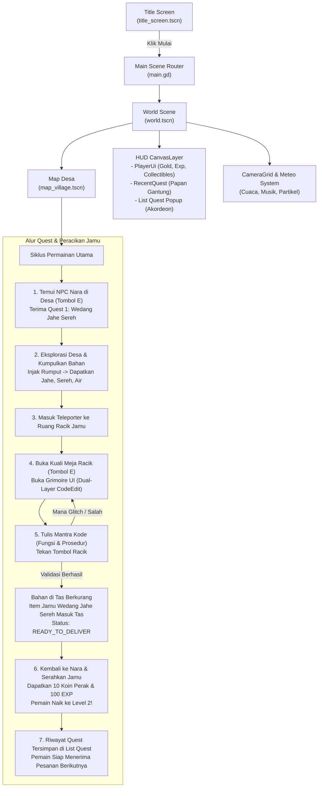

# PROJECT CONTEXT — SYNTAXIA

Dokumen ini mendefinisikan konteks umum, visi desain, latar belakang, alur aplikasi, serta fitur-fitur inti dari game **Syntaxia** untuk memastikan setiap AI Agent yang bekerja pada proyek ini memiliki pemahaman komprehensif terhadap produk.

---

## 1. Identitas Proyek

* **Nama Proyek:** Syntaxia
* **Platform & Engine:** PC / Desktop & Web HTML5 (Godot Engine versi 4.7+, Forward+ Renderer)
* **Genre:** 2D Top-Down Action Adventure / Crafting & Educational Coding RPG (Pixel Art)
* **Tema Utama:** Petualangan eksplorasi desa & peracikan jamu tradisional Indonesia berbasis pemrograman (*Traditional Indonesian Herbal Alchemy & Educational Code Crafting*).

---

## 2. Latar Belakang & Masalah yang Diselesaikan

### Latar Belakang
Indonesia memiliki kekayaan budaya jamu dan pengobatan herbal tradisional yang melimpah (seperti Jahe, Serai, Kencur, Beras Kencur, Gula Merah, Asam Jawa). Namun, pengetahuan mengenai bahan-bahan alami ini sering kali dirasa kuno atau kurang diminati oleh generasi muda. Di sisi lain, pembelajaran dasar pemrograman (*computational thinking*) seperti Fungsi dan Prosedur sering kali terasa abstrak dan membosankan jika diajarkan hanya melalui teori kelas.

### Masalah yang Diselesaikan
* **Gamifikasi Edukasi Herbal & Coding:** Menggabungkan pengenalan rempah tradisional dengan konsep dasar logika pemrograman (Fungsi vs Prosedur, parameter bahan, nilai balik/return value).
* **Peracikan Jamu Berbasis Logika:** Pemain meracik jamu bukan dengan menyeret item semata, melainkan mengetikkan mantra kode yang mendefinisikan proses ekstraksi bahan dan penyeduhan secara terstruktur.
* **Pengalaman Eksplorasi Alami:** Menghadirkan siklus alamiah di mana pemain menjelajahi desa, menemukan tanaman liar, dan memanen bahan tanpa terasa membosankan melalui sistem kemunculan acak dan kelangkaan bahan (*rarity*).

---

## 3. Target Pengguna (Audience)

* Pemain game petualangan 2D retro / pixel-art klasik.
* Pelajar atau masyarakat umum yang tertarik dengan edukasi botani/jamu tradisional Indonesia dan dasar pemrograman komputer dalam format interaktif yang menyenangkan.
* Penggemar mekanisme *cozy gathering*, *crafting*, dan *questing*.

---

## 4. Konsep & Alur Kerja Aplikasi (Game Workflow)

### Rincian Alur Teknis:
1. **Inisialisasi Game:**
   * Titik masuk utama (`res://content/menu/title_screen.tscn`) menuju `res://main.tscn` lalu `res://world.tscn`.
2. **Setup Dunia & Lingkungan (`world.tscn`):**
   * Memuat map awal `map_village.tscn`, sistem cuaca/meteo, kamera sel grid `CameraGrid`, dan HUD Kanvas.
3. **Penyematan Karakter Pemain:**
   * `PlayerAssignor` menyematkan target kamera ke pemain, memasukkan pemain ke grup `"player"`, serta mengaktifkan Layer 5 (Player).
4. **Siklus Pengumpulan Bahan (Harvesting Cycle):**
   * Pemain menginjak rumput (`Grass`). Rumput hancur dan melempar rempah berbobot parabola sejauh 16–24 px.
   * Bahan disimpan di singleton `PlayerInventory` (maksimal 5 buah).
5. **Siklus Quest & Edukasi Alkimia (Quest Lifecycle):**
   * Pemain berbicara dengan NPC Nara untuk mengaktifkan Quest 1 (`QuestManager.start_quest(1)`).
   * Papan gantung `RecentQuest` dan jendela `QuestDetailPopup` memperbarui target bahan secara live.
   * Pemain meracik di Kuali Ruang Racik dengan menulis kode Fungsi & Prosedur pada `GrimoireUI`.
   * Saat jamu jadi, pemain menyerahkan ke Nara dan mendapatkan 10 Koin serta 100 EXP (naik ke Level 2).
   * Riwayat quest tersimpan rapi pada sistem akordeon List Quest.

---

## 5. Rangkuman Seluruh Fitur Utama

1. **Top-Down Character Controller:**
   * Pergerakan 8 arah berbasis `CharacterBody2D` dengan pembekuan otomatis (*freeze*) saat modal antarmuka aktif.
2. **Combat & Damage Area System:**
   * Pemisahan modular antara `DamageArea` (senjata) dan `Hitbox` dengan sistem tim sekutu (`ResourceDamageTeam`).
3. **Sistem Tanaman Liar (Grass & Weighted Drop):**
   * Rumput liar khusus yang hancur saat disentuh tubuh pemain dan menjatuhkan 7 jenis rempah alami berbobot.
4. **Fisika Lemparan & Kedaluwarsa Item (Collectible Physics):**
   * Item melompat parabola membal ke tanah, bertahan 30 detik, berkedip di 5 detik terakhir, lalu memudar jika diabaikan.
5. **Grass Spawner & Bounding Box Kamera:**
   * Pengatur kemunculan rumput berbasis `Marker2D` yang mempertahankan kuota 80% rumput aktif dan mencegah pop-in di kamera.
6. **Penyimpanan Inventory Backend (Session-Only):**
   * Autoload `PlayerInventory` dengan batas kapasitas 5 item per jenis bahan dan reset otomatis tiap sesi.
7. **Pusat Manajemen Quest (`QuestManager`):**
   * Singleton terpusat yang mengatur status quest, EXP, kenaikan level, koin, dan database pesanan (`QUEST_DATABASE`).
8. **UI Grimoire dengan Permanent Ghost-Text:**
   * Meja racik interaktif dengan teknik Dual-Layered `CodeEdit` di atas aset bingkai kayu `code_terminal_ui_wood`.
9. **Educational RecipeParser:**
   * Parser sintaks edukatif yang memeriksa aturan Fungsi vs Prosedur, parameter bahan, return value, dan pencegahan resep level lain.
10. **Jendela List Quest Akordeon (Expand & Shrink):**
    * Daftar pesanan berlatar `UI_QuestList.png` yang menampilkan seluruh riwayat quest yang pernah diambil, secara default shrink dan dapat dibuka rinciannya saat diklik.
11. **Companion Follow System:**
    * Companion robot dan buku mantra yang mengikuti pergerakan pemain di map desa secara mulus.
