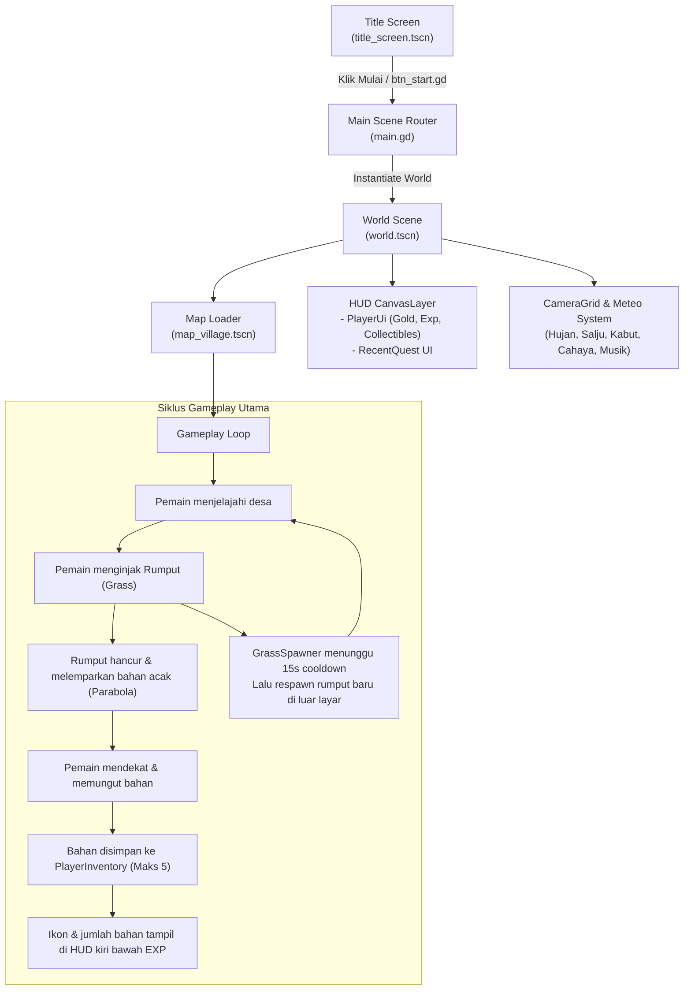

# PROJECT CONTEXT — SYNTAXIA

Dokumen ini mendefinisikan konteks umum, visi desain, latar belakang, alur aplikasi, serta fitur-fitur inti dari game **Syntaxia** untuk memastikan setiap AI Agent yang bekerja pada proyek ini memiliki pemahaman komprehensif terhadap produk.

---

## 1. Identitas Proyek

* **Nama Proyek:** Syntaxia
* **Platform & Engine:** PC / Desktop (Godot Engine versi 4.7+, Forward+ Renderer)
* **Genre:** 2D Top-Down Action Adventure / Crafting RPG (Pixel Art)
* **Tema Utama:** Petualangan eksplorasi desa & peracikan jamu tradisional Indonesia (*Traditional Indonesian Herbal Alchemy*).

---

## 2. Latar Belakang & Masalah yang Diselesaikan

### Latar Belakang
Indonesia memiliki kekayaan budaya jamu dan pengobatan herbal tradisional yang melimpah (seperti Jahe, Serai, Kencur, Beras Kencur, Gula Merah, Asam Jawa). Namun, pengetahuan mengenai bahan-bahan alami ini sering kali dirasa kuno atau kurang diminati oleh generasi muda karena minimnya media interaktif edukatif yang menyenangkan.

### Masalah yang Diselesaikan
* **Gamifikasi Edukasi Herbal:** Menyajikan pengenalan bahan-bahan rempah dan jamu tradisional melalui mekanisme gameplay petualangan (*harvesting*, *crafting*, dan *questing*) yang adiktif, mirip game retro Zelda dan Stardew Valley.
* **Pengalaman Eksplorasi Alami:** Menghadirkan siklus alamiah di mana pemain menjelajahi desa, menemukan tanaman liar, dan memanen bahan tanpa terasa membosankan melalui sistem kemunculan acak dan kelangkaan bahan (*rarity*).

---

## 3. Target Pengguna (Audience)

* Pemain game petualangan 2D retro / pixel-art klasik.
* Pelajar atau masyarakat umum yang tertarik dengan edukasi botani/jamu tradisional Indonesia dalam format interaktif.
* Penggemar mekanisme *cozy gathering* & *crafting*.

---

## 4. Konsep & Alur Kerja Aplikasi (Game Workflow)

### Rincian Alur Teknis:
1. **Inisialisasi Game:**
   * Titik masuk utama (`run/main_scene` di `project.godot`) mengarah ke `res://content/menu/title_screen.tscn`.
   * Menu utama menyediakan tombol Start (`btn_start.gd`) dengan transisi fade-out warna hitam menuju `res://main.tscn`.
   * `main.gd` memuat `res://world.tscn`.
2. **Setup Dunia & Lingkungan (`world.tscn`):**
   * Memuat map awal `res://content/map/map_village.tscn`.
   * Mengaktifkan sistem cuaca/meteo (partikel hujan, kabut, salju, daun berguguran, dan pencahayaan dinamis).
   * Memasang kamera sel kotak (*grid camera*) `CameraGrid`.
   * Memasang HUD kanvas 2D yang memuat `PlayerUi` dan `RecentQuest`.
3. **Penyematan Karakter Pemain:**
   * Di dalam map, karakter utama (`Main Character`) memiliki node `PlayerAssignor`.
   * `PlayerAssignor` menyematkan target kamera ke pemain, memasukkan pemain ke grup `"player"`, serta mengaktifkan **Layer 5 (Player)**.
4. **Siklus Pengumpulan Bahan (Harvesting Cycle):**
   * Pemain berjalan dan menabrak rumput (`Grass`).
   * Rumput mendeteksi sentuhan pemain dan hancur (kebal serangan senjata tebasan).
   * Item melompat keluar (*scatter & bounce*) sejauh 16–24 px dan mendarat di tanah.
   * Pemain berjalan mendekat untuk memungut item.
   * Item masuk ke `PlayerInventory` (maksimal 5 buah).
   * Tampilan HUD di bawah bar EXP otomatis memperbarui jumlah item yang dimiliki.
   * `GrassSpawner` mencatat posisi asal, menunggu cooldown 15 detik, dan memunculkan rumput pengganti di area yang sedang tidak dilihat oleh kamera pemain (kuota terjaga 80%).

---

## 5. Rangkuman Seluruh Fitur Utama

1. **Top-Down Character Controller:**
   * Pergerakan 8 arah berbasis fisika `CharacterBody2D` dengan akselerasi, deselerasi, dan animasi arah 4-arah (`SpriteCharacter`).
2. **Combat & Damage Area System:**
   * Pemisahan modular antara `DamageArea` (pemberi luka/senjata) dan `Hitbox` (penerima luka) dengan sistem tim sekutu (`ResourceDamageTeam`).
3. **Sistem Objek Hancur (Destroyable Architecture):**
   * Kelas dasar `Destroyable` untuk segala objek interaktif yang memiliki nyawa (`ResourceLife`), efek getar/flash/partikel saat hancur, dan drop item.
4. **Sistem Tanaman Liar (Grass & Weighted Drop):**
   * Rumput liar khusus yang hancur saat disentuh tubuh pemain.
   * Menjatuhkan 7 jenis rempah alami dengan probabilitas berbobot (*weighted random drop rate*).
5. **Fisika Lemparan & Kedaluwarsa Item (Collectible Physics):**
   * Item melompat parabola membal ke tanah sebelum bisa diambil pemain.
   * Masa hidup 30 detik di tanah, berkedip di 5 detik terakhir, lalu menghilang perlahan jika diabaikan.
6. **Grass Spawner & Bounding Box Kamera:**
   * Pengatur kemunculan rumput berbasis `Marker2D`.
   * Mempertahankan kuota 80% rumput aktif.
   * Cooldown 15 detik dan penghindaran kemunculan di dalam viewport kamera pemain aktif.
7. **Penyimpanan Inventory Backend (Session-Only):**
   * Autoload `PlayerInventory` dengan batas kapasitas 5 item per jenis bahan.
   * Reset otomatis saat sesi game ditutup/dimulai kembali.
8. **Dynamic Collectible HUD UI:**
   * Antarmuka di kiri atas layar (di bawah bar EXP) yang menampilkan ikon bahan dan jumlah koleksi secara real-time.
9. **Kamera Retro Grid (CameraGrid):**
   * Kamera berpindah antar-sel ruangan secara mulus (*smooth tweening*) saat pemain melewati batas grid, layaknya game klasik 2D.
10. **Sistem Cuaca & Atmosfer (Environment Meteo):**
    * Partikel dinamis (hujan, kabut, daun, sinar cahaya) dan koreksi warna gradien (*color grading LUT*) yang dapat berganti otomatis berdasarkan area lingkungan.
